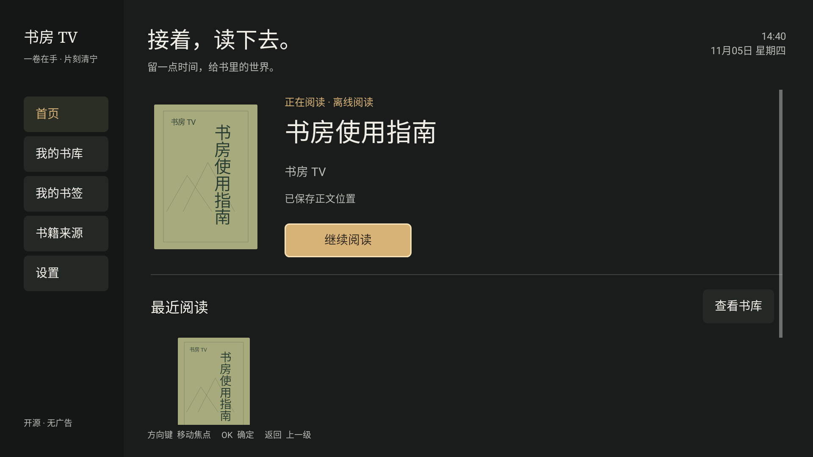

# 书房 TV · ShufangTV

面向中文家庭书库的原生 Android TV 开源阅读器。深灰背景、暖白文字、琥珀色焦点，为电视和遥控器设计。Android 8.0（API 26）及以上。

**在线阅读与离线阅读是两个独立操作。** 在线打开按格式读取所需数据，临时内容留在内存，不自动保存离线书籍。EPUB 按章节和图片读取；AZW3/MOBI 需要在内存重建所选文件的压缩记录。只有主动选择“保存到本地”，才会写入完整离线副本。

这是独立编写的新项目，不是原 TVReader 的汉化补丁。UI 延续通过 OpenDesign Cloud / Local Codex 完成的“暗色书房”设计，并以原生 Android View 实现。新增网盘来源、扫码、目录选择与阅读方式面板已按设计稿优化；[设计原型](design/README.md)与[落地说明](docs/UI-DESIGN.md)随源码保存。

[下载测试版 APK](https://github.com/spudhero/ShufangTV/releases/tag/v0.2.0-alpha.2) · [网盘连接说明](docs/CLOUD-CONNECTIONS.md) · [验证记录](docs/VALIDATION.md) · [原生界面图](docs/SCREENSHOTS.md)



## 功能

- 中文首页、书库、阅读页、书签、书籍来源与设置；遥控器焦点、方向键与分层返回。
- 原生 4K 布局、独立高清内容绘制及自动 / 兼容模式；部分电视仍会由系统缩放，详见 [4K 验证与设备限制](docs/DISPLAY-4K-2026-11-06.md)。
- EPUB 图文、纯图片漫画、无 DRM 的 AZW3/MOBI（兼容 AZW/PRC）、TXT 与 PDF；进度、书签、目录跳转和阅读主题。
- 首页与书库显示书籍真实封面；兼容 EPUB 2/3、封面页与 SVG、Kindle 内嵌封面，PDF 使用完整第一页。按比例完整显示，后台按需读取并缓存缩略图。
- 插图按正文顺序显示，支持 ZIP 内图片、SVG 包图与内嵌图片；普通插图完整适配，连续画页按屏宽阅读，也可手动切换。
- PDF 默认全屏撑满屏宽，上下滚动；菜单可放大至 125%–300%，左右平移，并恢复 100% 屏宽。
- 窄 / 中 / 宽居中阅读栏，排版可选全局默认或仅本书；调整后保留文字位置。
- EPUB 本章 / TXT 当前片段正文搜索、命中高亮、上下条与返回搜索前位置；每书搜索历史。
- 逻辑书单、置顶、待读 / 在读 / 已读筛选；来源文件保持原位置。
- 文本书籍前台朗读、段落高亮、语速、媒体键和定时停止；默认应用内离线中文，无需系统 TTS。可选自行配置 Azure 网络语音，或使用系统引擎。
- 遥控器选段、摘录备注、回到原文，以及通过系统文件保存界面导出文本 / Markdown。
- 可调自动翻页；关菜单后恢复，主动暂停或手动翻页后需主动继续。
- 阿里云盘、百度网盘、夸克与 UC 网盘原生扫码直连；选择文件夹作为书籍来源。同一账号可添加多个文件夹。
- SMB 家庭共享、WebDAV、本地与 USB 文件。
- 在线打开、保存离线、离线打开、单独删除离线副本，分别提供明确入口。
- 电视本地 / USB 文件使用系统文件选择器授权，直接读取原文件，不再复制一份。
- 网盘会话与来源凭据使用 Android Keystore 加密保存，无书房 TV 云端账号、广告和统计 SDK。

## 在线与离线

| 场景 | 行为 | 电视存储 |
| --- | --- | --- |
| 在线打开 | SMB 按偏移读取；网盘直链与 WebDAV 使用严格校验的 HTTP Range | 保存进度、来源记录与有上限的私有封面缩略图；正文和原图只在内存 |
| 保存到本地 | 显示大小、剩余空间，用户确认后下载；支持取消和失败清理 | 完整成功后才登记离线副本 |
| 离线打开 | 仅打开已保存副本或已授权的本地 / USB 原文件 | 不连接远程来源 |
| 删除离线副本 | 只删除应用保存的文件，保留在线入口、进度与书签 | 释放离线文件占用 |

服务器不支持随机读取、忽略 Range、文件变化或读取失败时会报错，**不会自动退回整本下载**。小书的全部字节可能自然落入一次读取窗口；在线模式仍不会将其保存为离线文件。PDF 的实际请求范围由系统渲染器决定。

EPUB 先读取 ZIP 中央目录，再按 spine 加载当前章节。ZIP 原始数据缓存最多 1 MiB，正文保留最近两章，单章上限 8 MiB；图片按需读取，单张输入上限 16 MiB、采样解码最多 8,294,400 像素，只保留当前位图。Kindle 所选文件上限 64 MiB、解压正文上限 32 MiB，支持 KF8、旧 MOBI 与目录锚点拆章；不绕过 DRM。PDF 仅绘制当前可见区域，放大不会生成整页巨型位图。TXT 每段最多 48 KiB，支持 UTF-8、带 BOM 的 UTF-16、GB18030。离线保存上限 128 MiB。

在线与离线副本共享阅读位置。文本偏移采用 Java UTF-16 单元；TXT 额外保存段首字节，图片保存纵向位置，PDF 保存页索引、缩放与平移位置；旧记录兼容。

## 使用

1. 在“书籍来源”选择网盘，使用对应手机应用扫码并确认，然后选择书籍文件夹。UC 使用“UC 浏览器”扫码。也可添加 SMB / WebDAV 家庭书库。
2. 选中 EPUB、AZW3、MOBI、TXT 或 PDF，选择“在线打开”。需要离线时另选“保存到本地”。
3. 正文左右键翻页，确定键打开菜单，下键进入底部操作区，上键返回正文，返回键逐层退出。
4. “字体与排版”直接调整字号、行距、字体和栏宽；顶端选择全局默认或仅本书。图文书“亮度与纸色”的纸色使用同一范围，显示亮度始终全局；PDF 的“阅读亮度”仅调整亮度。
5. “收藏正文段落”用上下键选择，确定键保存并写备注；在“我的书签”选择卡片管理和回到原文，“导出收藏”选择格式后保存。
6. 在设置页“朗读与语音 → 管理朗读语音”下载约 30.1 MiB 的中文语音包；安装后不依赖系统语音，可断网朗读。首次安装可能需要数分钟。“朗读正文”的语速和停止时间位于“朗读设置”；应用进入后台会暂停，返回后需主动继续。自动翻页与朗读、搜索、选段互斥。
7. 图片页可在菜单切换“适合整图 / 100% 适合屏宽”。屏宽图片上下移动，左右连续翻阅。PDF 上下滚动，100% 时左右翻页；放大后左右平移，菜单中仍可切换页码。

阅读体验增量与 OpenDesign UI 优化见 [任务计划](docs/READING-ROADMAP.md)、[界面验收与对比](docs/READING-UI-REVIEW.md)。主干当前开发版为 `0.5.0-alpha.2`；上面的下载页保留已发布的 `0.2.0-alpha.2`。独立语音的实现、UI 与电视证据见 [语音接入验收](docs/SPEECH-INTEGRATION.md)。真实封面及 16 本实际书籍的本轮结果见 [封面修复验收](docs/COVER-VALIDATION-2026-11-06.md)。UI、图标和听书准备状态见 [UI 复核记录](docs/UI-AUDIT-2026-11-06.md)；实际 SMB 图文、PDF 与 Kindle 格式验收见 [媒体阅读记录](docs/MEDIA-READING-VALIDATION-2026-11-06.md)。前一阶段的 173 项检查及图片缺失结论保留在 [历史 SMB 记录](docs/SMB-DEVICE-VALIDATION-2026-11-06.md)。

网盘由本应用直接授权和读取，不需要 CloudDrive2 服务或第三方登录中转。会话失效时重新扫码；阿里令牌支持自动续期。原文件能否按需读取取决于网盘权限和 Range 支持，拒绝时会提示，不自动下载整本书。SMB / WebDAV 的局域网 HTTP 仍可用，网盘连接使用 HTTPS。

## 构建

需要 JDK 17、Android SDK Platform 36、Build Tools 36.0.0、NDK 27.2.12479018 和 CMake 3.22.1。原生库同时构建 armeabi-v7a、arm64-v8a、x86 与 x86_64。构建会通过 Python 3 下载并校验固定版本的官方 sherpa-onnx Android 运行库，缓存于 `.build-cache/speech/`；语音模型不打包进 APK。

```sh
git clone https://github.com/spudhero/ShufangTV.git
cd ShufangTV
# 设置 ANDROID_HOME，或在未跟踪的 local.properties 中填写 sdk.dir。
./gradlew :core:test :app:testDebugUnitTest :app:lintDebug :app:assembleDebug
```

设备回归另运行 `:app:assembleDebugAndroidTest`。先在应用内安装语音包，再安装测试 APK，执行 `adb shell am instrument -w io.github.spudhero.shufangtv.test/androidx.test.runner.AndroidJUnitRunner`，覆盖阅读原生库与离线语音。覆盖安装使用相同开发密钥；可通过 `-Pshufang.debugKeystore=/path/to/debug.keystore` 指定已有测试密钥。

安装包：`app/build/outputs/apk/debug/app-debug.apk`。这是使用开发签名的测试版本，正式分发需自行配置发布签名。仓库提供 [GitHub Actions 模板](ci/android.yml)，有工作流管理权限时将它放入 `.github/workflows/`，可自动构建并上传 APK、测试报告和原生界面渲染结果。

## 当前边界

- 不支持 DRM、KFX 和在线 ZIP64。图文按原顺序逐屏阅读，不复刻原书全部 CSS 排版；SVG 滤镜及动态图像动画不在当前范围。
- 无跨设备进度同步、全文 TXT 目录扫描；不绕过网盘的文件权限、会员限制或额外验证。
- 正文搜索限当前已加载章节 / 片段；PDF 不提供文字搜索、重排、朗读和段落选取。
- 离线朗读为 8 kHz 中文通用音色，音质以[实际样音](docs/audio/sony-offline-chinese.wav)为准；首次需下载语音包，取消后不支持断点续传。仅前台播放。Azure 需自行提供有效凭据，正文会发送至该服务且可能计费，不会自动启用。书单为单层、每书一个归属。
- 本地/USB 与外部导出需有可用的系统文档界面；Sony 上只有占位组件时显示恢复提示，收藏仍保留。远程文件提供方若不能 seek，会明确失败。
- 四家网盘匿名二维码初始化已核对；真实账号扫码后的目录、会话续期和文件读取仍待验收。协议夹具通过不等于真实账号已通过。
- Sony Android 10 上的在线 PDF 代理描述符、真实 NAS/SMB 读取及空闲重连已验证。离线中文已通过 Sony JNI / AudioTrack 实测；Azure 线上发声、有效文档提供器上的文件交接、物理遥控器长按和实际观看距离仍待对应条件验收。

见 [架构与存储规则](docs/ARCHITECTURE.md)、[验证记录](docs/VALIDATION.md)、[阅读行为分析](docs/REFERENCE-BEHAVIOR.md)、[CD2 网盘参考边界](docs/CLOUD-REFERENCE.md)、[第三方依赖](THIRD-PARTY-NOTICES.md)。网盘流程也依据用户授权的本地 NetVplayer 源码核对，公开仓库只记录行为差异和自有实现；不包含该项目源码、参考 APK、反编译源码、凭据、用户书籍或签名密钥。

## License

应用代码采用 [Apache-2.0](LICENSE)；单独链接的 libmobi 为 LGPL-3.0-or-later，随仓库提供对应源码与重建说明，见 [第三方声明](THIRD-PARTY-NOTICES.md)。TVReader 和 CloudDrive2 仅用于本地研究功能行为，不包含其源码、二进制、图标或商标素材。
