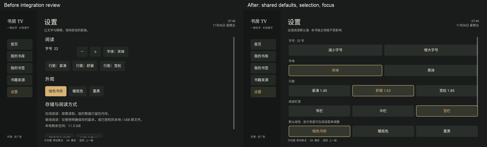
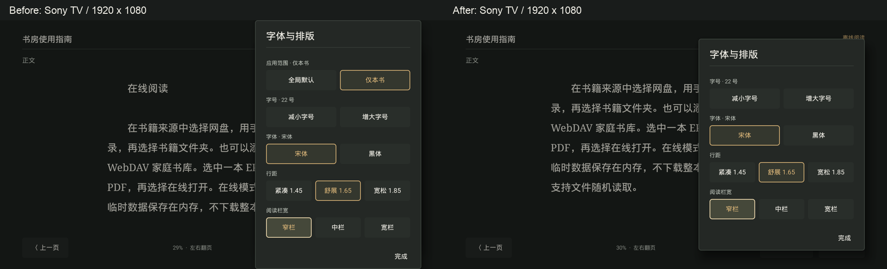

# 整体 UI 复查

2026-11-06；参考：现有 `design/` 的 OpenDesign 暗色书房/云盘规范，以及阅读功能的原生侧面板。实现：MainActivity、ReaderScreen、ReadingPanel、SourceUi、CloudLoginDialog。原生渲染 API 31，960×540dp/1920×1080px 和 640×360dp/1280×720px，density 2；另在 Sony BRAVIA / API 29 / 960×540dp 完成设备复核。

## 发现与修复

| 编号 | 级别 | 观察与影响 | 修复及复核 |
| --- | --- | --- | --- |
| UI-01 | P1 | 设置缺少栏宽，行距没有当前值；与阅读器可调内容不一致 | 复用 ReadingStyle 和 ReadingPanel；五组默认值都明确显示选中项 |
| UI-02 | P1 | 每次改设置重建页面，焦点回到页首 | 按设置标签恢复；720p 检查栏宽及页底动作完整可见 |
| UI-03 | P2 | 关于仍写死 alpha.1，操作说明遗漏六项新功能 | 从安装包获取版本；帮助和原创指南更新 |
| UI-05 | P1 | Sony 上长排版面板触及屏幕上下边缘 | 自定义面板与原生列表共用高度上限，内容内部滚动；表单验证回归通过 |
| UI-06 | P2 | SMB/WebDAV、下载与进度仍使用默认样式 | 复用暗色 ReadingDialog，并保留表单校验 |
| UI-07 | P1 | Sony 文件保存解析到占位 Activity，立即返回且没有解释 | 已知占位组件显示明确恢复提示；收藏保留和快照清理检查通过 |
| UI-08 | P2 | 下载进度调用原生标题，未同步自定义标题 | 增加统一标题更新入口，保留下载与取消流程 |
| UI-04 | P2 | 普通消息使用默认对话框，视觉与其他侧面板不统一 | 统一使用暗色 ReadingDialog，保留原生消息滚动与按钮 |
| UI-09 | P1 | 真实长书名在阅读页换行，第二行裁切 | 书名/章节单行省略，模式标签独立，完整书名保留无障碍说明；合成布局回归与 Sony 复核 |
| UI-10 | P1 | 漫画章节只有插图占位符，没有能力说明 | 含图片的章节明确提示图片当前不支持显示，包括图文混排；保留正文锚点。图片渲染本身未实现，不计阅读通过 |
| UI-11 | P1 | 竖版 PDF 整页在电视上正文偏小 | 已确认加载和跳页正常；放大/平移留待实施，远距离可读性未通过 |

## 同尺寸对比

左右均为当前复查中捕获的实际原生设置页面（1920×1080），默认 22 号；不把原型图当成 APK。字体使用系统中文，背景、表面、文字、琥珀和焦点沿用现有 tokens，无新增图像资产。检查了文字、间距、边框、字号、长路径、书卡元信息和可滚动内容。

720p 下底部说明/关于可以获得焦点且完整显示；页面上方已离开视口的项目可以通过方向键回滚。当前选中和焦点样式不同。

## 逐页范围

首页首次启动与继续阅读、书库来源/书单/状态筛选、收藏与导出、四家网盘入口、扫码、目录、在线/离线操作、阅读菜单及四种模式控制条、全局设置与消息。自动化均通过；Sony 安装后的实际截图与问题回归记入 [集成记录](docs/INTEGRATION-2026-11-06.md)。

## 实机问题复测

最终包在 Sony 上复测 UI-05 至 UI-08：长排版面板上下各留 80px，标题/完成可见，方向键将当前选项滚入面板；家庭书库表单使用暗色输入和固定保存区；本地/导出占位界面显示恢复提示；下载自定义标题能显示实时字节。全局设置切换栏宽后仍聚焦当前值，页底操作和实际版本号也通过。

以下同为 1920×1080、22 号宋体/窄栏、焦点落在窄栏；合并图在同一输入中检查了边距、裁切、边框、选中与焦点。面板内部滚动位置按当前焦点决定，背景文字位置来自各次捕获。

前一阶段 UI-01 至 UI-08 的原生渲染及 Sony 回归通过，相关问题已修复并重新捕获。实机核心流程和精确位置证据见 [集成记录](docs/INTEGRATION-2026-11-06.md)。真实账号扫码后页面、实际语音/外部文件交接、物理遥控器长按和观看距离仍有明确边界。

真实 SMB 补充结果：UI-09 已修复，UI-10 的限制说明已补齐，UI-11 仍待实施；不把漫画或 PDF 远距离可读性计为通过。用户书页与长标题对比只保存在本地，公开回归使用合成内容。详见 [SMB 验证](docs/SMB-DEVICE-VALIDATION-2026-11-06.md)。
