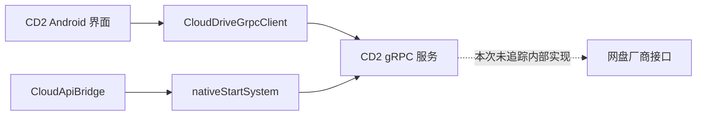

# 四家网盘直连的参考分析

分析日期：2026-11-05。当前产品目标是书房 TV 自行完成阿里云盘、百度网盘、夸克、UC 的扫码登录、目录选择和在线阅读，不调用 CloudDrive2 服务，不使用 CD2/WebDAV 代理。本目标取代此前参考说明中的 CD2/WebDAV 连接建议。

本次继续静态分析同一 CloudDrive2 Android 1.1.3（346）样本：包名 `com.clouddrive2.CloudDrive2`，APK SHA-256 为 `03cd7e685eab50a2c9db8958fabfe8f23a9af2577145c111afbab0b2fa8fb362`。使用 REA 6.8.0、jadx-headless-mcp 0.7.1、JDK 17。分析器来自[官方发布](https://github.com/1013503897/jadx-headless-mcp/releases/tag/v0.7.1)，摘要已核对。原始方法体、消息结构和分析失败记录仅留在被 Git 忽略的 `private-analysis/`。

本记录只有抽象行为、接口名和证据标识，不发布参考实现、应用秘密、登录凭据或厂商签名实现。没有运行 APK、使用真实账号或验证厂商接口；以下静态观察不等于书房 TV 已可连接任何网盘。

## 首要结论

CD2 Android 的相关界面主要调用它自己的 gRPC 服务。`CloudApiBridge.initializeLocked` 会启动 native 系统，等待初始化，再取得 gRPC 端口。因此从 Android 包装方法中看到的 `APILogin…`、`GetSubFiles`、`GetDownloadUrlPath` 是 CD2 接口，不能当作阿里、百度等厂商可直接调用的 API。

这能参考界面状态和接口分层；厂商二维码申请、扫描轮询、目录分页、直链签名及自动刷新仍需独立实现，不能用 CD2 RPC 包装层冒充完成。

## 四云入口的实际覆盖

| 网盘 | 在此 APK Android 层确认的入口 | 尚未确认的内容 |
| --- | --- | --- |
| 阿里云盘 | `CloudProvider.ALIYUN_DRIVE`；`loginAliyundriveQRCode`、`loginAliyundriveOAuth`、`loginAliyundriveRefreshToken` | 厂商二维码 URL、实际轮询请求、扫码状态码、请求签名、自动 token 轮换和直链生成。 |
| 百度网盘 | `CloudProvider.BAIDU_PAN`；OAuth 配置与 `loginBaiduPanOAuth` | 自有二维码申请/轮询接口、授权页面是否提供扫码、token 交换和自动刷新、厂商目录和下载协议。 |
| 夸克 | 在该版本 `CloudProvider` 枚举、`OAuthConfig` 配置与 `CloudDriveGrpcClient` 方法清单中未定位到对应入口 | 全部厂商登录、目录、直链与刷新协议。不能由这个样本推断已复现。 |
| UC | 在上述清单中未定位到对应入口 | 全部厂商登录、目录、直链与刷新协议。不能由这个样本推断已复现。 |

额外对该 APK 的 12 个 DEX 和 arm64 `libcloudapi.so` 做了明确厂商标识扫描，未找到 Quark/UC 网盘域名或 UC 网盘标识。native 中的 `quark` 字面命中属于 QuarkXPress 的 MIME 名称，不能作为夸克网盘支持证据。这只是补充字节扫描，不是完整的 native 反汇编或功能不存在证明。

## 可以确认的 Android 行为

### 扫码状态交付

`CloudAccountsViewModel.startQRCodeFlow` 在 ViewModel 协程中启动流程。阿里分支调用 `CloudDriveGrpcClient.loginAliyundriveQRCode`；后者构造请求并消费 `APILoginAliyunDriveQRCode` 的 gRPC Flow，参数包含是否使用 Open API 及 API/数据代理配置。

UI 消费的 `QRCodeScanMessageType` 包含：`SHOW_IMAGE`、`SHOW_IMAGE_CONTENT`、`CHANGE_STATUS`、`ERROR`、`CLOSE`。界面分别处理二维码地址/内容、展示状态、错误，以及关闭对话框后重新加载账号。这里的 `CHANGE_STATUS` 是服务消息，不能据此推断厂商固定状态码或轮询间隔。没有在这条 Android 路径中确认厂商轮询实现。

### OAuth、token 与账号状态

`OAuthManager.startOAuth` 取得提供商配置，可通过 CD2 的 `createOAuthState` RPC 生成 state，再构造授权 URL 并等待回调。该 state/callback 流程属于 CD2，不应被书房 TV 当作自有授权后端使用。

`loginBaiduPanOAuth` 接收 refresh token、access token、有效期及可选代理配置，构造 `LoginBaiduPanOAuthRequest` 后发给 CD2 RPC。`loginAliyundriveRefreshToken` 也是把 refresh token 与 Open API 标志交给 CD2 登录 RPC；方法名不能证明 Android 实现了厂商 token 刷新，更不能证明后台自动刷新周期。

`getCloudAccounts` 通过 `GetAllCloudApis` 获取结果，把名称、昵称、用户名、路径和只读信息映射到界面模型；其中可用标志来自 `!CloudAPI.isLocked`。这个标志不足以证明 token 当前健康或厂商授权仍有效。书房 TV 应区分已保存账号、授权有效、需要重新登录和暂时网络失败。

### 目录与文件链接

`getSubFiles` 构造 CD2 `ListSubFileRequest`，传入路径、强制刷新等选项，返回 `SubFilesReply` 的 Flow。这里没有暴露厂商目录 ID、页标或各厂商分页规则，不能把 Flow 的分批消息直接视为厂商分页协议。

`getDownloadUrl` 的协程先调用 CD2 `GetDownloadUrlPath`。若响应的 `directUrl` 非空则返回它，否则把 `downloadUrlPath` 拼成 CD2 本机 HTTP 服务地址。实际厂商直链由 RPC 另一侧提供；Android 方法没有生成厂商签名。

`DownloadUrlPathInfo` 消息同时声明 `directUrl`、`downloadUrlPath`、`expiresIn`、`userAgent`、`additionalHeaders`。因此读链接应建模为“URL、必需请求头、User-Agent、有效期”的组合，而不是仅存一个字符串。消息字段存在并不保证所有服务端路径都填写它们，本次没有执行验证。

## 书房 TV 的独立接口要求

以下是为四云直连定义的重写要求，和上述静态观察分开，不表示参考 APK 已提供相应厂商实现。

- 每家提供商独立提供二维码申请、状态查询/事件、会话恢复、token 刷新、列目录、解析在线读链接与退出登录能力。账号不能通过 CD2 账号列表或 CD2 state 中转。
- 登录界面显示等待扫码、等待确认、成功、过期、取消和失败等本项目状态；具体厂商响应映射由各适配器定义。取消或页面退出要停止轮询；过期后显式重新生成，不无限后台重试。
- 书籍来源保存提供商、账号身份、目录 ID/路径和来源显示名。选择目录只记录来源，不默认下载目录下全部书籍。分页目录必须能继续加载，并把书籍、文件夹和不支持格式分清。
- 在线文件身份使用稳定文件标识和版本信息；带签名直链是可更新的读能力，不作为书籍永久身份。保留请求头和有效期，过期时由同一提供商重新解析。
- 在线读源依照当前格式请求所需字节。HTTP Range、URL 更新或认证重试必须保持对象版本一致；不支持随机读取时说明原因，由用户另行选择离线下载。
- 应用自己的会话持久化与刷新过程要避免并发刷新互相覆盖；公开仓库不嵌入参考 APK 的 client secret、账号 token 或厂商 Cookie。需要自有应用注册参数的能力须显式配置并验证。

## 证据索引

下列证据 ID 对应本地保留的 REA JSON。方法为 Java 表示时可能带反编译警告；标注 smali 的方法使用完整 DEX 方法体核对。类/消息元数据不代表运行覆盖。

| 检查对象 | 证据与表示 |
| --- | --- |
| 提供商枚举 / OAuth 配置清单 | `ev_6c672a196c678e53174fe48e74cb3248b870032da39c7a1e7d5cb002ac3cc3c2` / `ev_1d61988bdcef0d3ff53e29fdc782efa7af74206d933ca0293cdc393ddc8fd443`；类元数据 |
| Android gRPC 客户端方法清单 | `ev_86aa5a803438c7446a237a790240d5ca4ce5e44aecb4c2920706f5684f74308d`；类元数据 |
| native 服务初始化与端口 | `ev_0ca0148dbe32761d3c35874eb222c0eb3454937d47ab03c69954cb22e1ca8523`；`CloudApiBridge.initializeLocked` Java |
| 扫码事件消费与 UI | `ev_f6dfc4658b922abd6a0c6b29b89f701b1ac927cc453663852d83de117cd4adb9`；`CloudAccountsViewModel$startQRCodeFlow$1.invokeSuspend` Java |
| 阿里二维码 RPC | `ev_f067f091be2ce4281156ba45420867f2dfba411c9240e9615e9cffd9326bc943`；`CloudDriveGrpcClient$loginAliyundriveQRCode$1.invokeSuspend` smali |
| OAuth state 和 URL 构造 | `ev_711015f64ed312f0fdf62e9543b34ae9cd5dbfb7f4c42c66b3ef9a5413b24352`；`OAuthManager.startOAuth` 重载 0，smali |
| 百度 OAuth token 交付 | `ev_708f6f1c50fc841f3bace18b44502fc5ac68afe5401dceca2faefb6fefb4ecd4`；`loginBaiduPanOAuth` Java |
| 阿里 refresh token 交付 | `ev_4445525c67cd8d8453eaaab025116c977d9bfb3b9061015c5d887206d9ffa3e7`；`loginAliyundriveRefreshToken` Java |
| 账号状态映射 | `ev_50eca9e8bdd6bdb2ecbc2e338016a6fc32fd8433f3da308f6060e4e852b46e80`；`getCloudAccounts` 协程 Java |
| 目录 RPC | `ev_5654bee5c4d8a208a861623eaa8dd6e3a9d1db45f75f2f6f3a3fb8f112a18e2b`；`getSubFiles` Java |
| 直链或 CD2 本机地址选择 | `ev_f9d7b12fa3e00558a50df08fd01a68f4970d780981db97e6a421fb591ce7ff94` / `ev_8b4e8ee8346350b3253d2b5598efd062e913d7766fa513b06dee85d2b056e33f`；下载 URL 协程 / 构造方法 Java |
| URL、头信息和有效期结构 | `ev_08f4f9bee3f432a2256f30084480728b8372c325d54a125b1e4b2e9bb0fc2732`；`DownloadUrlPathInfo` 类元数据 |

## 仍需独立验证

四家厂商真实二维码与授权协议、有效会话建立、目录页标、直链头信息、签名有效期、刷新 token 轮换、失效恢复、Range 支持和限流行为均未通过本次静态分析验证。夸克和 UC 在此样本中尤其没有可复核的登录入口。

`OAuthConfig` 的静态初始化方法未被 REA 成功导出，失败诊断已保留；没有由此推测配置内容。native 厂商实现和网络请求路径未做反汇编或动态跟踪。使用开放文档或单独授权、可核对的其他参考来源补足这些缺口后，仍须在书房 TV 自己的提供商实现上验证，不能以“CD2 已支持”代替端到端测试。
