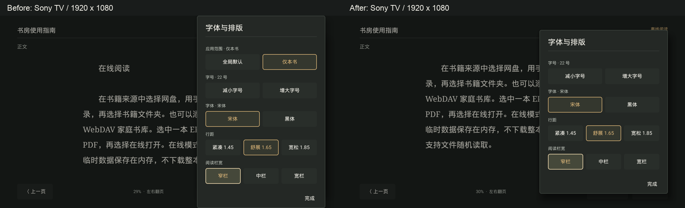

# 主干集成与 Sony 验证

日期：2026-11-06；开发版 0.3.0-alpha.1，版本码 4。

后续同日已完成真实 Huawei SMB 书库抽查并修复空闲读取、长标题和图片章节提示；当前检查数 **173**，最终安装包及验收缺口见 [SMB 实机补充验证](SMB-DEVICE-VALIDATION-2026-11-06.md)。下文 170 项及 Sony 安装包校验值保留为前一阶段历史证据。

## 分支集成

原生云盘来源分支 `codex/native-cloud-sources` 与旧 main 同在 `81a3c0e`。云盘 UI 分支 `codex/cloud-ui-delivery` 的 `d40dfab` 已在 origin/main。先独立提交阅读功能 `5c92582`，再将本地 main 快进到 origin/main，使用 `880db22` 合并阅读分支 `codex/cloud-ui-polish`。没有文本冲突；仍检查共享 MainActivity 的来源、书库、收藏、导出、阅读和返回行为。所有现有本地分支均已包含在主干，保留分支与其他工作区。

## UI 补漏

全局设置页复用阅读面板的暗色选项和当前值标记，补齐栏宽。字号统一为 16–40；字体、行距、纸色和栏宽都保留选中状态。修改后按稳定标签恢复焦点，滚动立即到位；不会改动本书独立排版。关于页面读取实际安装版本，帮助和原创指南补充搜索、收藏、朗读和自动翻页。普通消息统一使用暗色阅读弹窗。

对比及边界图见 [UI 检查](../design-qa.md)。原生测试图不能代替设备结果。

## 自动化和安装包

运行仓库要求的 `:core:test :app:testDebugUnitTest :app:lintDebug :app:assembleDebug`；JDK 17、Gradle 8.13、SDK/Build Tools 36。离线 Robolectric 运行时及来源校验值见 [历史验证](VALIDATION.md)。

- core 38、app 132，合计 **170 项**；失败、错误、跳过均为 0。
- lint 0 错误、20 个警告，涉及程序化 View、字符串、绘制分配与存储 API 提示；未添加基线掩盖问题。
- 四项新增设置/表单/系统组件检查覆盖全局/本书隔离、40 号边界、焦点恢复、动态版本以及 640×360dp 下选项与底部操作的完整可见性。
- 安装包 `artifacts/ShufangTV-0.3.0-alpha.1-sony-final-debug.apk`：7,065,595 字节；SHA-256 `96e0c9626ee5733f54ecea4f35bfde67514a785035fd0a1d85a3f06a2d5a7538`。
- 原项目本地测试证书 SHA-256 `9aeb612cabfb2d39bd0d7b40f212a562c0aee3440a9bd4b84e376f335ab6e0e0`，APK v2/v3 签名验证成功。保留旧版本 APK、标签和校验记录；密钥及安装包不进入源码 Git。

## Sony 实机

设备为 Sony BRAVIA 4K UR2，Android 10/API 29，1920×1080，320dpi（960×540dp）。通过已授权 ADB 安装、截屏和注入方向/确定/返回事件；这是物理电视上的应用测试。没有以 JVM 结果代替实机结果，也没有据此认定物理遥控器长按或客厅观看距离已验收。

初始未安装书房 TV；首轮安装后以相同项目测试证书覆盖更新，进度、本书排版、WebDAV 来源和备注均保留。最终 APK 对应代码提交 `d7920a5`，电视已安装 `0.3.0-alpha.1` / 版本码 4。读取设备 `base.apk` 的 SHA-256，与上述最终包完全一致。

首轮 Sony 截图发现长排版面板触及上下边缘；已将自定义内容与原生列表都限制在高度安全区，并统一 SMB/WebDAV 表单、下载、进度和删除确认弹窗。表单显示后再绑定校验，避免覆盖通用样式回调。重新运行全部 170 项检查成功，安装包重新签名。

Sony 的文件请求解析到 `com.google.android.tv.frameworkpackagestubs` 后直接返回。新增已知系统占位组件检测：本地/USB 与导出明确说明缺少系统界面，导出不会生成临时快照或丢失收藏；正常处理器和查找受可见性过滤时继续走原流程。下载进度同时更新自定义标题。

### 实际操作结果

网络测试使用本机临时 WebDAV 服务，经 ADB 端口转发提供三本自行生成的 EPUB、TXT、PDF；不含用户书籍、账号或授权票据。首轮到最终修正版连续回归；最终修正版重点复核系统组件提示、下载、离线冷启动、排版和设置。

| 场景 | 结果 | 实机证据与边界 |
| --- | --- | --- |
| 首页、方向键、返回、继续阅读 | 通过 | 中文界面、分层返回、正文翻页；[结束时首页](screenshots/sony-2026-11-06/home.png) |
| WebDAV 来源保存与恢复 | 通过 | 系统输入法输入地址、保存成功；进程重启/覆盖安装后能恢复加密来源并浏览；[暗色表单](screenshots/sony-2026-11-06/webdav-form.png) |
| 在线 EPUB 与文本翻页 | 通过 | 三章测试 EPUB 进入正文；返回来源恢复所选书籍；在线期间无新增离线文件 |
| 当前章节搜索 | 通过 | 超过 200 条明确提示上限；方向键选择结果、下一条至 2/200、回到搜索前位置；[高亮与唯一控制栏](screenshots/sony-2026-11-06/search.png)；搜索没有额外网络请求 |
| 选段、备注、重开 | 通过 | 指南的 UTF-16 范围 86–210，备注 `sony-tv-qa`；多次覆盖与冷启动后仍保留；[收藏页](screenshots/sony-2026-11-06/notes.png) |
| 自动翻页 | 通过 | 5 秒间隔、菜单暂挂/恢复、手动暂停保持；位置记录见下表；[暂停画面](screenshots/sony-2026-11-06/auto-paused.png) |
| 在线 PDF | 通过 | 在实际系统 PdfRenderer / 代理文件描述符上打开、翻至第 2/2 页；[PDF 画面](screenshots/sony-2026-11-06/online-pdf.png)；菜单没有不支持的文本操作 |
| 在线 TXT 按需读取 | 通过 | 450 KiB 文件首次正文只请求 `bytes=0-49151`，返回 49,152 字节；翻页成功，未创建整本副本 |
| 显式保存与进度 | 通过 | 确认后才完整 GET 460,915 字节；[标题实时显示 64 KiB / 450 KiB](screenshots/sony-2026-11-06/download-progress.png) |
| 关闭服务后离线与冷启动 | 通过 | 服务端进程终止后打开，再强停应用/重启并继续阅读；offset 123 保持，模式为 offline；[离线冷启动](screenshots/sony-2026-11-06/offline-cold.png) |
| 排版、全局设置与关于 | 通过 | 本书 22 号/窄栏保留；全局中/宽栏切换后焦点恢复，最后恢复宽栏；页底操作完整，关于显示实际 alpha.1；[设置](screenshots/sony-2026-11-06/global-settings.png)、[页底](screenshots/sony-2026-11-06/settings-bottom.png)、[关于](screenshots/sony-2026-11-06/about.png) |
| 中文朗读 | 降级提示通过，声音未验收 | 系统未安装 TTS 服务；入口明确提示需要中文语音引擎，不能宣称语音、媒体键或音频焦点实机通过 |
| 本地/USB 与外部导出 | 降级提示通过，文件交接未验收 | 系统只有 DocumentsStub；[本地打开提示](screenshots/sony-2026-11-06/local-unavailable.png)、[导出提示](screenshots/sony-2026-11-06/export-unavailable.png)；备注未丢失 |
| 清理与稳定性 | 通过 | 删除测试 TXT 离线副本、三本测试记录及临时来源；移除本轮端口转发；留下指南和 1 条备注，应用停在首页；本次收集日志未发现本包崩溃/ANR |

### 暂停策略的设备位置记录

数值来自同一本在线 EPUB 的持久化章节/文字位置，均在 chapter 0；不是靠两张画面猜测是否翻页。

| 状态 | 观察时长 | 起点 → 终点 | 判断 |
| --- | --- | --- | --- |
| 自动运行 | 7.2 秒 | 119 → 283 | 实际推进 |
| 菜单打开 | 7.3 秒 | 365 → 365 | 暂停 |
| 关闭菜单 | 20.9 秒 | 365 → 701 | 自动恢复 |
| 手动暂停后开关菜单 | 9.7 秒 | 785 → 785 | 保持暂停，符合用户确认策略 |

### 在线与离线核对

下载前应用私有 books 目录只有原创指南（1,869 字节）。下载后的 TXT 大小 460,915 字节，设备副本与源文本的 SHA-256 均为 `41aa909003f60b56117cd92f62138fac44baf40a85b2e732487ecbf8d741c48a`。关闭服务后的离线打开和冷启动没有新增服务器请求，最终请求记录仍为 20 条。冷启动恢复的是原文第 3 段附近，offset 123；百分比因大文件四舍五入仍显示 0%。测试清理后目录恢复为仅指南。

### UI 同尺寸回归

同一 Sony、同为 1920×1080、指南 22 号宋体/窄栏、焦点落在窄栏。左图为修复前，右图为最终修正版；内容根据焦点在面板内部滚动，背景阅读位置来自各次捕获。

最终面板上下各保留 80px，标题与“完成”固定可见，当前项没有被底部遮住。其他实机画面见 [九步概览](screenshots/sony-2026-11-06/overview.png) 与 [截图索引](SCREENSHOTS.md)。

### 保留的验收边界

真实四家云盘账号扫码后的目录、会话续期、真实 NAS/SMB、支持中文的 TTS 输出、可用文档提供器上的 USB/外部导出，以及物理遥控器长按和观看距离仍需对应条件。它们不计为本轮实机通过项。此前的原生渲染记录和旧版本证据继续保留。
