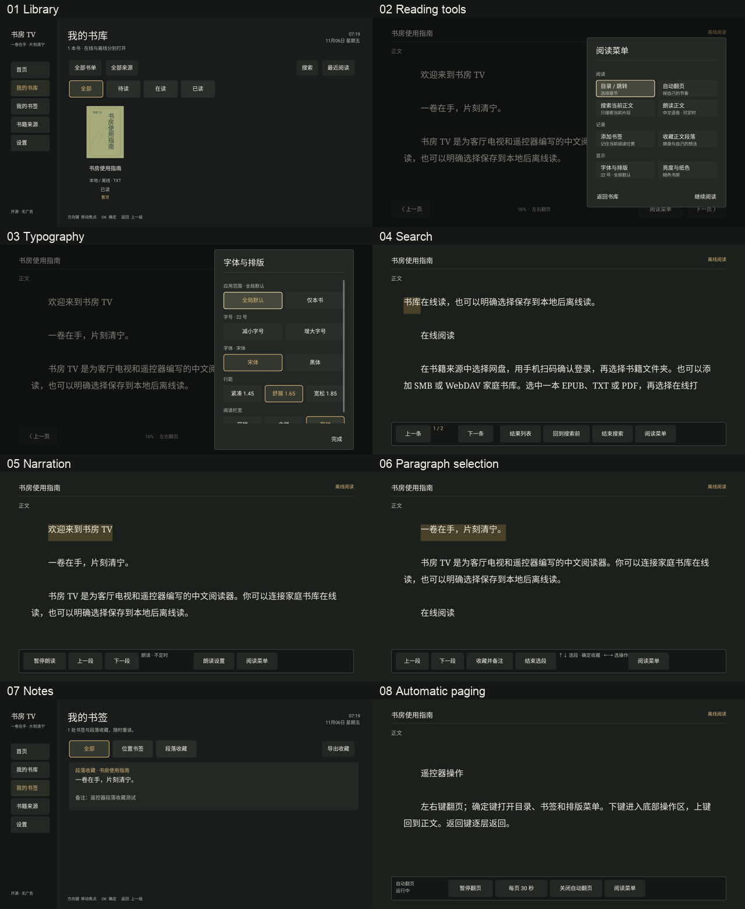
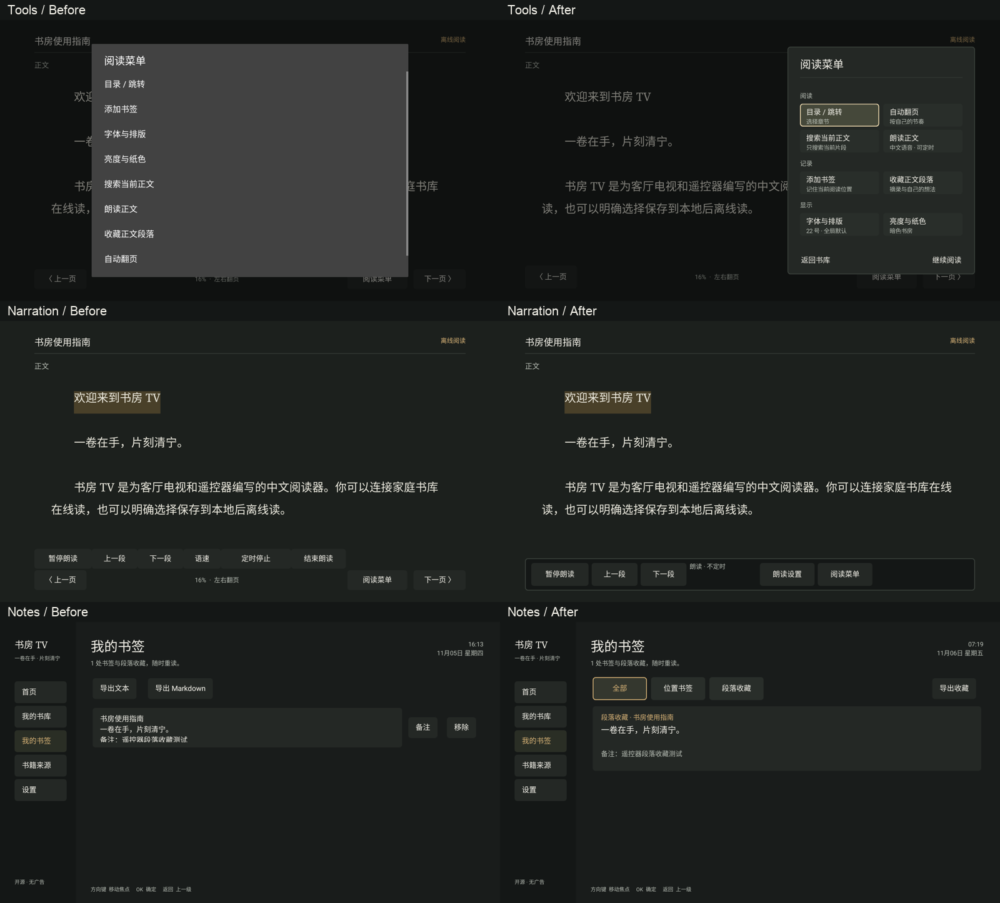
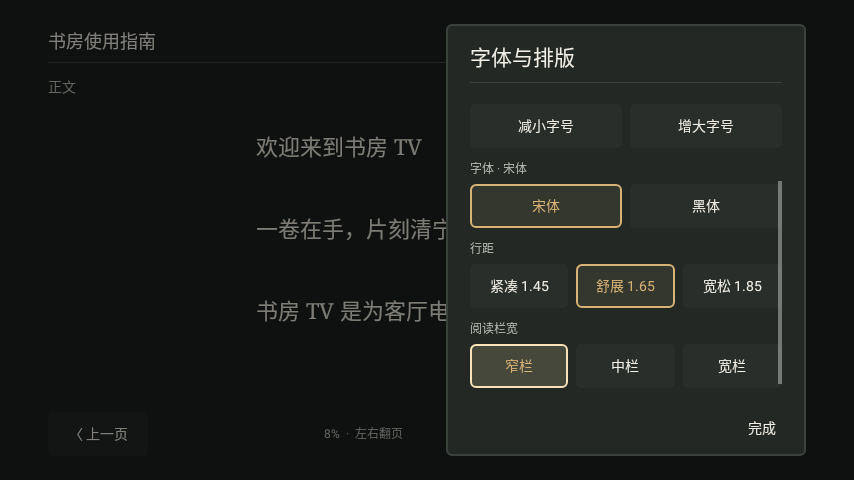
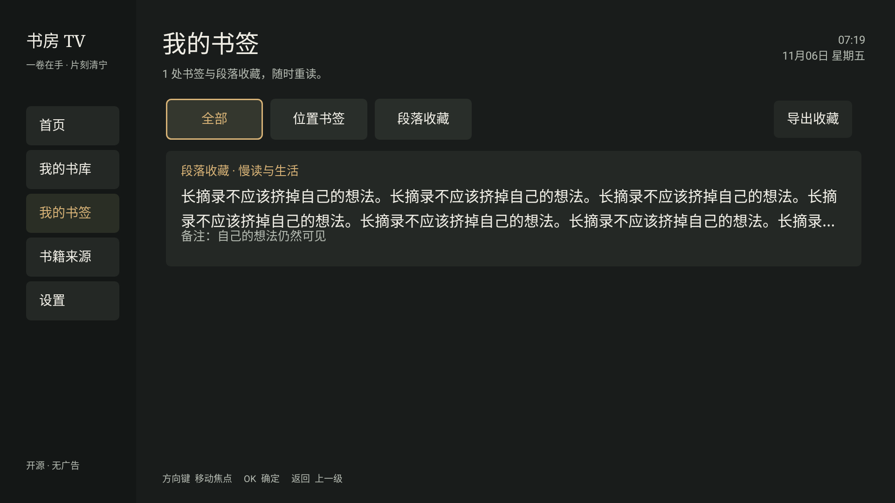
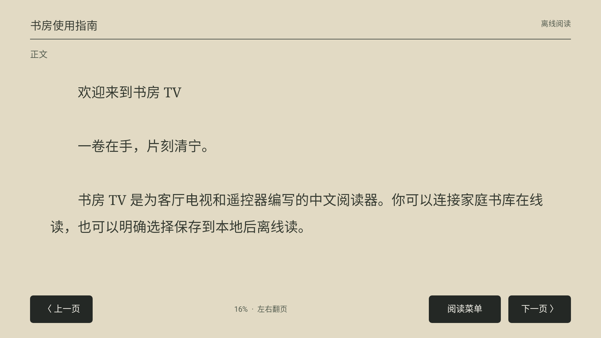

# 阅读功能 UI 整体验收

日期：2026-11-06。基于现有“暗色书房”设计，使用 OpenDesign Cloud 和 Local Codex 生成交互原型，再落地到 Java 原生 View。原型新增 `reading-features.html`、独立样式与脚本，保留既有首页与云盘设计。

## 优先处理的问题

| 优先级 | 观察到的问题 | 原生实现 |
| --- | --- | --- |
| P0 | 模式控制栏与普通翻页栏同时出现，占用正文空间 | 搜索、朗读、选段和自动翻页各使用唯一上下文栏，启用后隐藏普通栏 |
| P0 | 九项工具连续排列，缺少功能层级 | 360dp 暗色侧面板，按阅读 / 记录 / 显示分组，双列入口；退出固定在底部 |
| P0 | 焦点重建后回到第一个控件，小画面当前项可能被裁切 | 按稳定标签恢复书卡 / 设置 / 收藏焦点；设置即时更新且无滚动动画，确保当前项完整可见 |
| P1 | 设置当前值与全局 / 本书范围分散 | 面板直接选择范围、字号、字体、行距与栏宽；选中状态与焦点分别表现；纸色注明范围，亮度注明全局 |
| P1 | 书卡把置顶、阅读状态、来源挤成一行 | 四列书架；来源 / 格式、阅读状态、置顶分别显示；来源下拉与直接状态标签 |
| P1 | 收藏内容、备注和操作混在首层 | 类型筛选、独立摘录与备注行；选择卡片后管理；单一导出入口再选格式 |
| P1 | 朗读控制过密，自动翻页暂停原因不清 | 语速 / 定时收进朗读设置；自动翻页显示运行、菜单暂挂、等待正文或主动暂停 |
| P1 | 读者界面出现内部计数术语 | 输入提示改用正文、备注等读者用语；精确 UTF-16 上限保留在数据实现中 |

## 流程记录

这些图片均为本轮实际 Android View / Robolectric native graphics 渲染，使用原创指南和测试元数据。它们不是电视实机截图。下表的“通过”指自动化与图形检查通过。

| 步骤 | 场景 | 状态与证据 |
| --- | --- | --- |
| 1 | 书库筛选与书籍状态 | 通过；长书名下的来源与状态不被裁切 |
| 2 | 阅读工具面板 | 通过；分组双列、暗色焦点、保留左侧正文 |
| 3 | 排版与本书范围 | 通过；当前值、原文位置、重建焦点；480p 当前项完整可见 |
| 4 | 局部搜索与回跳 | 通过；范围明确、命中高亮、回到原位置 |
| 5 | 朗读控制 | 通过；单条栏、设置入口、暂停与定时；实际声音待设备验证 |
| 6 | 遥控选段与保存 | 通过；方向键选段、确定保存、备注持久化 |
| 7 | 收藏列表与导出 | 通过；长摘录不挤掉备注；详情与原生列表共存；文档 URI 写入 |
| 8 | 自动翻页 | 通过；菜单关闭恢复，手动暂停保持，跨段与退出停止 |

## 同一流程改动前后

左侧为本轮优化前，右侧为优化后的原生渲染。使用同样的画面尺寸和功能状态；菜单背景压暗、正文重排位置及焦点由各自实际布局决定。

原生优化后的工具、朗读和收藏分别见 [工具面板](screenshots/reading-2026-11-06/02-tools.png)、[朗读控制](screenshots/reading-2026-11-06/05-speech.png)、[收藏列表](screenshots/reading-2026-11-06/07-notes.png)。

## 边界画面

480p 下，正在调整的栏宽完整显示，标题与“完成”操作保持可用。上方设置可通过方向键滚动查看。

长摘录的两行预览与一行备注分别布局；完整内容在详情阅读，避免备注被长原文挤出卡片。

暖纸色同时切换正文、章节、进度和阅读模式标签的文字颜色；小字标签对背景的对比度断言不低于 4.5:1。

## 范围与后续设备验收

OpenDesign 原型用于评估布局和流程，TTS、导出及书籍数据为模拟；原生接入系统 TTS 与系统文档保存。原型提出的多书单归属、独立 USB / NAS 来源细分等扩展未纳入本轮六项功能，当前仍为单层、每书一个书单。

API 31 原生渲染覆盖 1080p 和 480p，浏览器检查覆盖 720p 和 480p；实际中文语音、Sony 遥控器长按、系统输入法与文件保存交接仍需真机。截图可检查可读性和裁切，不能据此宣称全面无障碍合规。

实现与检查详见 [任务计划](READING-ROADMAP.md) 和 [验证记录](READING-VALIDATION.md)。
