# 原生界面与 Sony 实机图

## UI、听书准备与启动器 · 0.4.0-alpha.2

本轮结果见 [UI 复核](UI-AUDIT-2026-11-06.md)。实机图仅包含原创指南或应用设置；合成渲染与设备画面分别列出。

| 证据 | 图像 |
| --- | --- |
| Sony 原生设置与指南，1920×1080 | [设置前后](screenshots/ui-audit-2026-11-06/settings-comparison.png)、[指南菜单前后](screenshots/ui-audit-2026-11-06/guide-menu-comparison.png)、[缺少引擎提示](screenshots/ui-audit-2026-11-06/speech-setup-final.png) |
| Robolectric 原生 View，合成极长书名 | [1080p](screenshots/ui-audit-2026-11-06/home-title-1080p.png)、[720p](screenshots/ui-audit-2026-11-06/home-title-720p.png)、[720p 完整详情](screenshots/ui-audit-2026-11-06/home-title-720p-detail.png) |
| Robolectric 合成语音服务状态 | [720p 无服务](screenshots/ui-audit-2026-11-06/speech-settings-missing-720p.png)、[服务已检测、中文待检查](screenshots/ui-audit-2026-11-06/speech-settings-detected-1080p.png) |
| 本轮交付的真实启动资源，静态资产预览 | [图标与电视横幅](screenshots/ui-audit-2026-11-06/launcher-assets.png)；[Sony 应用卡片裁图](screenshots/ui-audit-2026-11-06/sony-launcher-crop.png)为实际设备画面 |

服务状态样例不证明中文可发声；本次 Sony 实测未安装语音引擎。用户实际书名、漫画 / PDF / Kindle 页面与首页前后对照保存在本地忽略目录，未纳入公开截图。

## Sony 实机 · 2026-11-06

BRAVIA 4K UR2，Android 10 / 1920×1080 / 320dpi；通过 ADB 捕获物理电视屏幕。内容为原创指南和自行生成的测试书，不含真实账号或授权票据。概览只缩小/拼接实际画面；单图保留原始分辨率。测试操作及限制见 [集成记录](INTEGRATION-2026-11-06.md)。

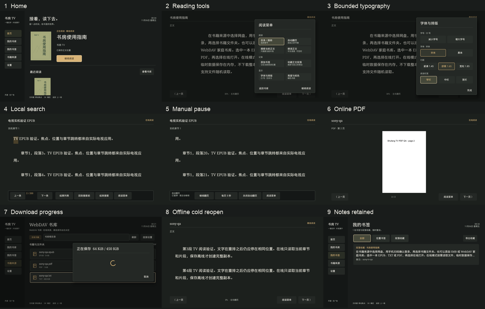

| 场景 | 实机图 |
| --- | --- |
| 首页与阅读工具 | [首页](screenshots/sony-2026-11-06/home.png)、[工具](screenshots/sony-2026-11-06/tools.png) |
| 排版安全区 | [最终面板](screenshots/sony-2026-11-06/typography.png)、[同尺寸前后对比](screenshots/sony-2026-11-06/typography-comparison.png) |
| 搜索与自动翻页 | [结果高亮](screenshots/sony-2026-11-06/search.png)、[手动暂停保持](screenshots/sony-2026-11-06/auto-paused.png) |
| 网络与离线 | [WebDAV 表单](screenshots/sony-2026-11-06/webdav-form.png)、[在线 PDF](screenshots/sony-2026-11-06/online-pdf.png)、[实时下载进度](screenshots/sony-2026-11-06/download-progress.png)、[服务关闭后离线冷启动](screenshots/sony-2026-11-06/offline-cold.png) |
| 收藏与系统限制 | [持久化备注](screenshots/sony-2026-11-06/notes.png)、[本地选择器缺失](screenshots/sony-2026-11-06/local-unavailable.png)、[外部保存界面缺失](screenshots/sony-2026-11-06/export-unavailable.png) |
| 设置与版本 | [全局默认值](screenshots/sony-2026-11-06/global-settings.png)、[页底完整焦点](screenshots/sony-2026-11-06/settings-bottom.png)、[实际版本号](screenshots/sony-2026-11-06/about.png) |

## Robolectric 原生渲染

以下图片由应用的原生 Android View 在 Android API 31 / TV 配置下，通过 Robolectric 图形引擎渲染；不是浏览器原型，也不是电视实机截屏。书籍为原创指南和自动生成的测试文本。保留历史发布与设计检查证据。

## 首页

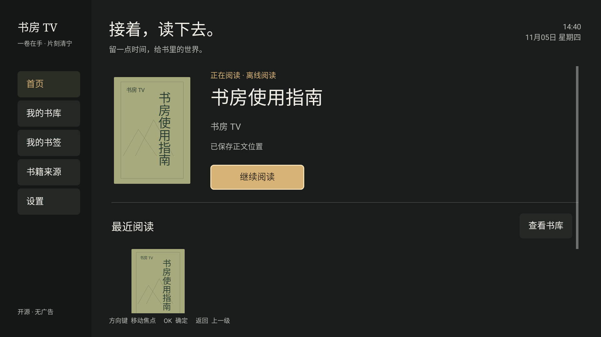

## 在线阅读

测试使用本机 HTTP Range 服务；此时离线目录为空。

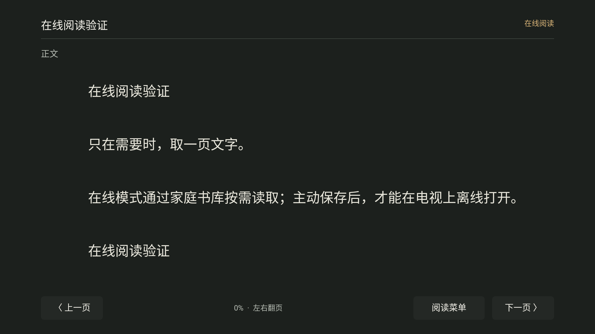

## 离线阅读

由用户主动保存同一本测试书；关闭测试服务后，仍可恢复进度。

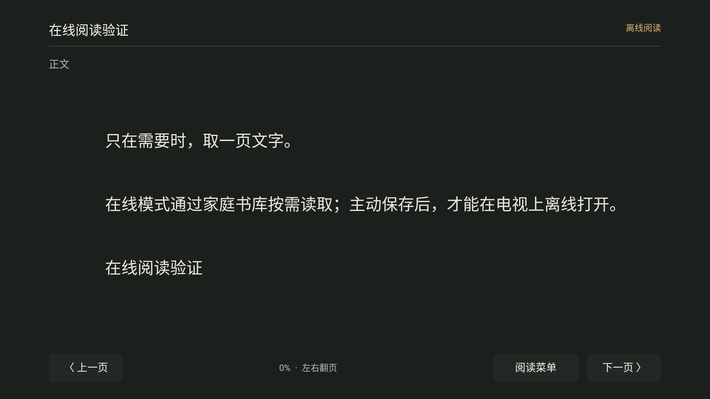

## 书籍来源

新版使用整卡网盘入口与紧凑的本地/家庭书库入口。

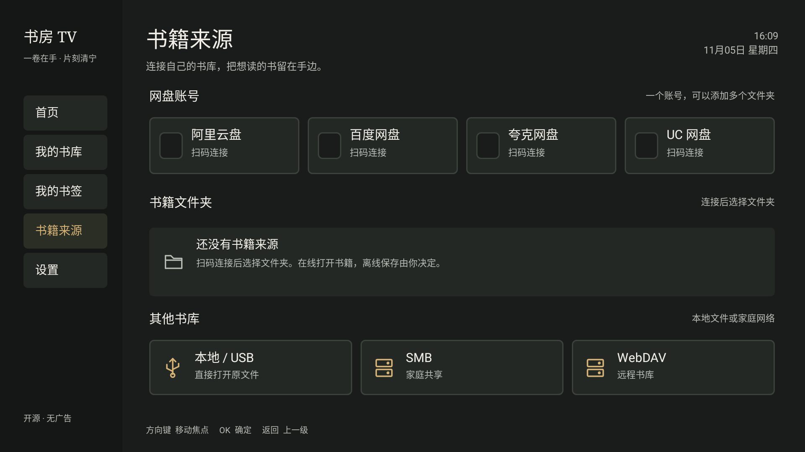

已连接账号、已保存文件夹与独立管理入口（合成测试会话）：

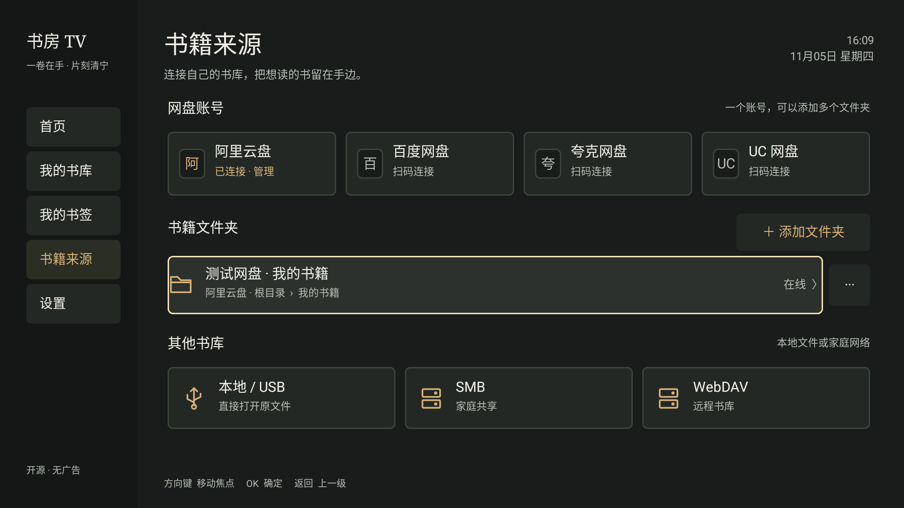

旧版 `0.2.0-alpha.1`，用于对照：

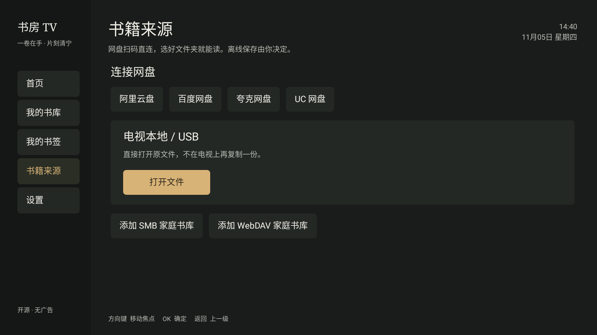

## 扫码登录与选择文件夹

以下使用合成的测试会话和不可用的示例二维码，展示原生交互，不包含用户账号或真实授权票据。

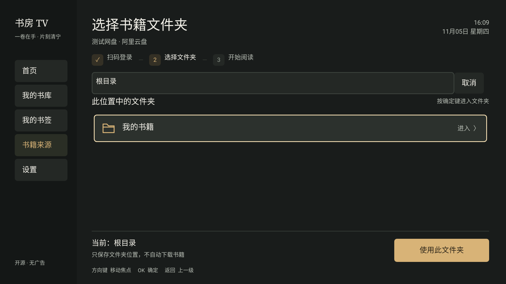

## 浏览书籍与选择阅读方式

类型和大小来自测试夹具，动作面板明确区分按需在线读取与占用存储的离线保存。

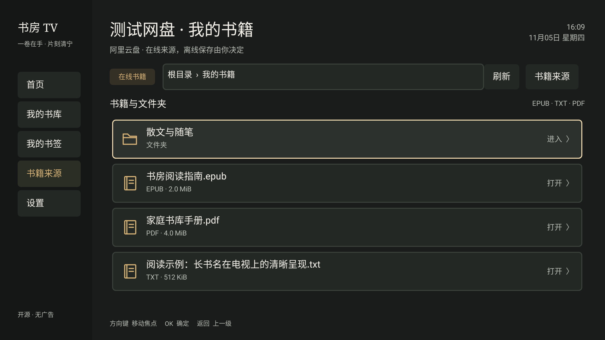

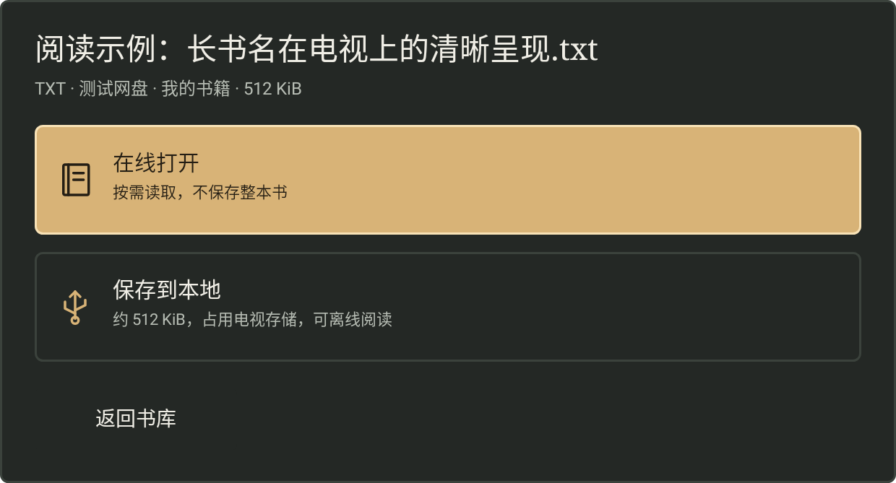

## 较小屏幕

以下使用 640×360dp / 1280×720 渲染配置。扫码与账号弹窗按自身窗口大小显示，目录页固定保留确认区。

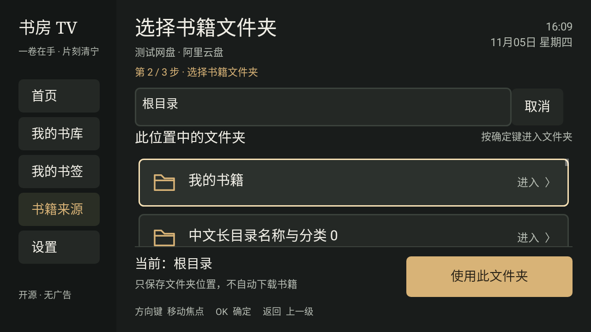

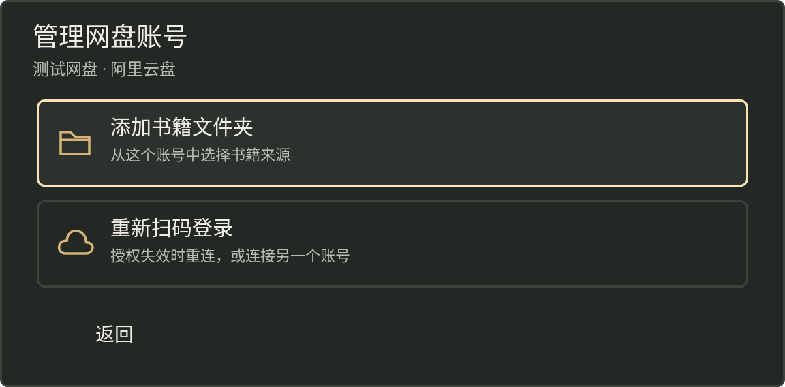

## 设置

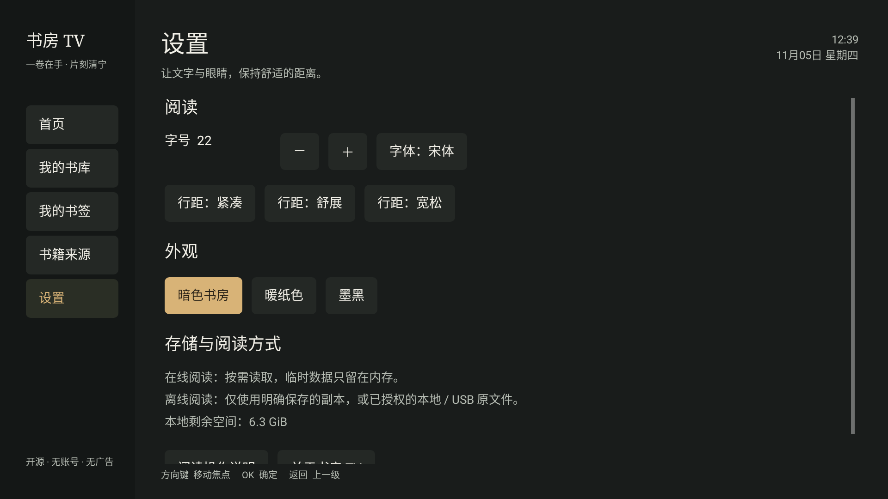

## 阅读指南

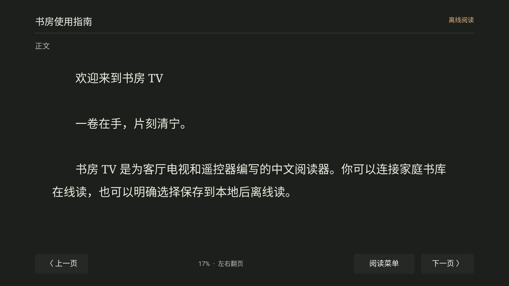
