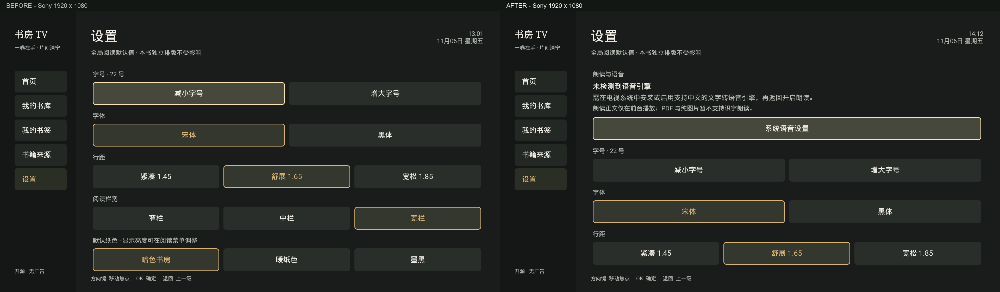

# UI、启动器与听书复核

2026-11-06，延续现有“暗色书房”视觉系统。现场复查 Sony BRAVIA 4K UR2 / Android 10 / 1920×1080；原生边界渲染覆盖 960×540dp 和 640×360dp，density 2。

## 发现与实现

| 优先级 | 观察 | 原生修订 |
| --- | --- | --- |
| P1 | 首页继续阅读标题固定 48dp，长书名第二行裁切 | 30sp / 紧凑屏 24sp，两行末尾省略、自然高度；作者单行省略，详情入口、原始书名和完整无障碍说明保留 |
| P1 | 朗读入口文案让无引擎设备看起来可以直接播放 | 菜单提前显示服务检测结果；缺少引擎时先说明安装条件，再提供系统设置入口 |
| P1 | 设置页缺少语音准备状态 | 顶部增加“朗读与语音”；区分未检测到服务与检测到服务；系统返回时按实际变化刷新并保留焦点 |
| P2 | 新图片和 PDF 操作没有同步到设置帮助 | 补充整图/屏宽、PDF 100% 屏宽、滚动、放大后平移及翻页说明 |
| P2 | PDF 显示纸色选项，但原页不跟随纸色变化 | PDF 仅显示有效的阅读亮度；图文书仍保留亮度与纸色 |
| P2 | 电视横幅只有书本，没有应用名称 | 使用既有书本图形和现有配色补齐启动器识别 |

## 听书当前状态

现有文本朗读已经接入系统 TTS，包含暂停/继续、上下段、段落高亮、语速、媒体键、15/30/60 分钟及正文末尾停止。应用进入后台暂停，返回后须主动继续。

服务检测只表示系统声明了语音服务，不证明有中文语音数据。真正开启时，ReaderSpeech 仍调用 setLanguage(Locale.SIMPLIFIED_CHINESE) 检查可用性，并管理音频焦点、定时和迟到回调。检测状态不会自行创建 TTS、下载数据或开始播放。

本次 Sony 的默认 TTS 为 null，系统 TTS 服务查询为空。因此这台电视目前不能实际发声；缺失提示和系统设置回退可以使用。需要先安装或启用兼容的中文 TTS 引擎及语音数据，再做实际中文声音验收。当前不提供后台连续播放，也不识别 PDF/纯图片中的文字。

## 图标与横幅

项目已有独立书本标识：深灰底 #191c1b、琥珀线条 #d8b377，原始资产是 drawable/ic_book.xml。原先由 Manifest 直接引用；本轮保留核心图形并改为自适应前景 / 背景资源。

Android TV 图标和横幅分别是启动入口。横幅应包含应用名称，320×180px 的 xhdpi 资源与当前电视适配；图标分离前景和背景，并给不同形状的系统蒙版留出安全区。依据 [Android TV 官方启动资源说明](https://developer.android.com/training/tv/get-started/create) 与 [Adaptive icons 官方规范](https://developer.android.com/develop/ui/compose/system/icon_design_adaptive)。

## 证据范围

实机书页和真实书名保留在本地忽略目录。OpenDesign Cloud / Local Codex 使用已核对的原创指南、合成书籍原生截图及既有图标作为设计参考。网页交互稿和设备原生画面分别标记；原型中的模拟语音状态不等于实际发声通过。

前一版本的 16 本 Huawei SMB 逐本图文、PDF、Kindle 格式结果保留在 [媒体阅读验证](MEDIA-READING-VALIDATION-2026-11-06.md)。本轮重点是 UI、启动器资源和语音准备状态。

## 验证与交付

开发版本 `0.4.0-alpha.2`，版本码 6。完成 187 项 JVM / 原生 View 测试和 2 项 Sony `ReaderDeviceTest`；lint 0 错误 / 21 条既有警告。构建保留四 ABI，覆盖安装保留原开发证书；本次 APK v2 签名验证通过。

本机最终 APK 与 Sony 已安装 `base.apk` 的 SHA-256 相同：`c444ffb1a369c69dda157f629c56d670b03ce6d76f1109c1489882e92dcc6628`。本地安装包保存在忽略目录 `artifacts/ShufangTV-0.4.0-alpha.2-ui-final-debug.apk`，未替换历史发布物。

| 检查 | 结果 |
| --- | --- |
| 极长书名 1080p / 720p | 两行省略不压住作者或继续阅读；完整详情、原始数据、无障碍说明与焦点返回通过 |
| 语音状态 1080p / 720p | 无服务与合成服务已检测状态分开显示；状态刷新保留焦点，不创建 TTS 或自动发声 |
| Sony 设置与阅读菜单 | 顶部语音准备可见；系统语音设置回退至 Sony 通用设置，返回焦点保留；缺少引擎时立即提示，不显示准备播放的假状态 |
| Sony PDF 菜单 | 仅阅读亮度，60% / 100% 当前值检查和恢复通过；原页面颜色不变 |
| 最终 APK 的实际 SMB 抽查 | 4 本书覆盖漫画 EPUB、PDF、AZW3、MOBI；加载、导航及长书名详情通过，漫画为真实插图；PDF 上下滚动通过 |
| Sony 应用列表 | 含应用名横幅完整显示，并可从启动器打开应用；公开图只裁取本应用卡片，完整桌面图保留本地 |
| 浏览器设计稿 | 首页与书名详情、720p 侧栏和主按钮焦点、语音缺失 / 中文待检查、PDF 菜单、启动器资产已复核；网页不执行真实阅读或播放 |

这轮没有把上一版 16 本逐本验证重写为新版的全量结果，也未将自动化的语音状态测试当成真实声音验收。真实中文输出、背景连续播放和 OCR 仍未通过本轮验收；后台连续播放及 OCR 当前不提供。

原始设计建议见 [UI-REFINEMENTS](../design/UI-REFINEMENTS.md)，最终原生行为以 [NATIVE-ADOPTION](../design/NATIVE-ADOPTION.md) 为准。全部公开图见 [截图索引](SCREENSHOTS.md)；真实用户书页只在本地报告中保存。

